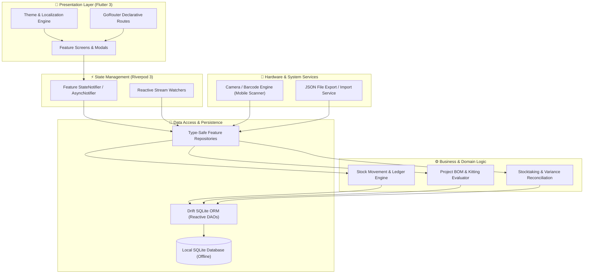

<!-- Gradient Divider -->


<!-- Dynamic Header -->
</img>

<!--Title-->
<p align="center">
  <b>PartPouch - Offline-First Electronic Component & Workshop Inventory Manager (v1.1)</b>
  <br> <small> <i>- A precision-engineered mobile inventory system with real-time stock balances, multi-location storage hierarchies, project BOM kitting, stocktaking audits, QR code labeling, and automated CI/CD releases -</i> </small> <br>
</p> 

<p align="center">
  <a href="https://flutter.dev"></a>
  <a href="https://dart.dev"></a>
  <a href="https://drift.simonbinder.eu/"></a>
  
  
  <a href="LICENSE"></a>
  
</p>

---

## 📌 Project Status

> [!NOTE]
> **PartPouch Mobile Inventory Ecosystem (v1.1.0)**  
> This repository contains the complete open-source PartPouch mobile application built with **Flutter 3**, **Riverpod**, and **Drift (SQLite)**. It is fully offline-first, supports dual-language localization (English & Persian), features QR code scanning and label generation, and operates with zero external server dependencies.

---

## 💡 The Problem & The Solution

Every hardware engineer, maker, and prototyping lab eventually hits the same roadblock: **inventory chaos**.

* ⚠️ **Spreadsheets fail fast:** Static spreadsheets don't scan QR codes, can't represent physical bin sub-locations, and inevitably fall out of sync during late-night soldering sessions.
* ⚠️ **Cloud tools introduce latency & risk:** Cloud ERP systems require continuous internet, impose subscription paywalls, and crawl to a halt inside metal RF-shielded workshops, basement labs, or remote makerspaces.
* ⚠️ **Small parts, catastrophic delays:** Misplacing a single \$0.05 10kΩ 0603 resistor or running out of STM32 microcontrollers unexpectedly can stall an entire production run.

### 🛡️ The PartPouch Engineering Philosophy
**PartPouch** treats physical component management with the rigor of an engineering toolchain:
1. **Zero Latency, 100% Local:** Everything lives in a local, transactional SQLite database with reactive Drift streams. No spinners, no cloud downtime, zero tracking.
2. **Granular Physical Topologies:** Map components down to the exact physical slot: `Workshop ➔ Cabinet B ➔ Rack 3 ➔ Drawer 12 ➔ Bin 4`.
3. **Audited Stock Ledger:** Every resistor received, consumed, or moved is committed to an immutable transaction ledger with unit cost tracking.
4. **Assembly-Ready BOM Kitting:** Know before heating up your soldering iron whether your warehouse has enough stock to build 5, 20, or 100 units of your PCB project.

---

## ✨ Core Pillars & Capabilities

### 🗄️ Multi-Tiered Storage Topology
* Model arbitrary physical spaces with parent-child location trees: *Building ➔ Room ➔ Rack ➔ Shelf ➔ Drawer ➔ Compartment*.
* Instant location code indexing for rapid bin identification during assembly.
* Complete visibility into all components sharing any given physical storage bin.

### 📜 Financial & Stock Movement Ledger
* **Four Dedicated Movement Vectors:**
  - 📥 **Receive:** Log inbound shipments, suppliers, batch quantities, and purchase prices.
  - 📤 **Use / Consume:** Deduct parts for breadboarding, prototype assemblies, or production runs.
  - 🔄 **Transfer:** Reallocate components between bins with preserved audit history.
  - ⚖️ **Adjust:** Correct counts following physical audits with tracked discrepancy notes.
* Chronological activity trail with automatic unit cost calculation.

### 🧩 Project BOMs & Kitting Verification
* Build comprehensive Bill of Materials (BOM) for hardware projects and PCB revisions.
* Real-time kitting engine checks warehouse inventory against required build quantities.
* Clear visual shortage alerts highlight exactly what needs to be ordered before production starts.

### 📷 Integrated QR Engine & Label Printing
* **Instant Camera Scanner:** Point your phone camera at any component QR code to open its live spec and stock screen in milliseconds.
* **On-Device Label Generator:** Render high-density QR payload codes for your component bins, SMD tape reels, and anti-static pouches.

### 📋 Cycle Counts & Stocktake Audits
* Conduct structured stocktaking sessions for specific rooms, shelves, or categories.
* Compares physical counts against system records in real time, calculating positive/negative variances.
* One-tap atomic reconciliation syncs database balances with actual inventory.

### 🌐 Bilingual Typography & Modern Theming
* Native **English** and **Persian (Farsi)** localization with full RTL (Right-to-Left) layout parity.
* Powered by the specialized **Vazirmatn** font family with 9 distinct weight cuts (Thin to Black).
* Seamless Material 3 Dark / Light modes and custom accent color selection.

---

## 🏛️ System Architecture

PartPouch is structured following clean domain-driven Flutter principles with unidirectional data flow and reactive database streams:



---

## 🚀 Key Feature Matrix

| Domain Vector | Technical & Functional Capabilities |
| :--- | :--- |
| **Component Catalog** | Multi-category filtering • MPN & internal SKU indexing • Footprint / package metadata (0805, QFN, SOIC) • Live datasheet URL integration • Low-stock threshold alerts |
| **Storage Hierarchy** | Unlimited multi-tier location tree (`Room ➔ Rack ➔ Shelf ➔ Drawer ➔ Bin`) • Fast location code lookup • Bin occupancy visualization |
| **Stock Ledger** | 4 atomic transaction modes (Receive, Use, Transfer, Adjust) • Chronological audit trails • Unit cost logging & stock valuation |
| **Project BOMs** | Assembly BOM builder • Component reservation check • Shortfall calculator • One-touch kitting status validation |
| **Purchase Orders** | Vendor relationship manager • PO pipeline (`Draft ➔ Ordered ➔ Received`) • Bulk receipt importing directly into bins |
| **Stocktake Audits** | Targeted cycle counting sessions • Real-time variance & discrepancy calculations • One-tap reconciliation |
| **Hardware Scanner** | On-device high-performance camera barcode/QR scanner • Fast component jump • Printable QR label generator |
| **Analytics & Backup** | Interactive financial & category distribution charts (FL Chart) • Atomic JSON backup & restore • One-click `demo.json` seed loader |
| **Theming & i18n** | True Dark & Light modes • Hex accent color picker • Full English & Persian (Farsi) translation with Vazirmatn typography |

---

## 📖 Full App Tutorial & User Guide

### 1. Initial Setup & Seeding Sample Data
Upon first launching PartPouch:
1. Open the **More / Settings** screen from the bottom navigation bar.
2. Navigate to **Data Backup & Restore**.
3. Tap **Load Demo Data** to populate your local database with 50+ pre-configured electronic components, multi-room storage locations, stock movement ledgers, suppliers, active project BOMs, and sample stocktake audits from `demo.json`.

### 2. Managing Components & Stock Levels
- **Adding a Component:** Tap the `+` Floating Action Button on the Inventory screen. Enter the component name, category (e.g., Microcontrollers, Resistors, Capacitors, Sensors), manufacturer part number (MPN), package footprint (e.g., 0805 SMD, DIP-8, QFN-32), datasheet URL, and minimum stock threshold.
- **Low Stock Alerts:** When total stock drops below the minimum threshold, PartPouch automatically flags the item in the **Low Stock** hub and highlights it with a warning badge on the dashboard.

### 3. Storage Hierarchy & Bin Locations
Organize components using physical storage trees:
1. Go to the **Locations** tab.
2. Create top-level locations (e.g., `Main Workshop`, `Lab Storage`).
3. Add child sub-locations (e.g., `Rack A ➔ Shelf 2 ➔ Drawer 15`).
4. Assign specific component stock balances to exact sub-location codes.

### 4. Stock Movements (Receive, Use, Transfer, Adjust)
- **Receive Stock:** Log incoming component purchases with unit costs, automatically updating total quantity and average unit value.
- **Use / Consume Stock:** Deduct components used during breadboarding, prototype assembly, or production runs.
- **Transfer Stock:** Move quantities from one storage bin to another with full audit logging.
- **Manual Adjustment:** Correct inventory counts following damage, loss, or quick manual checks.

### 5. Project Bill of Materials (BOM) & Kitting
1. Navigate to **Projects**.
2. Create a project (e.g., *Smart Power Metering Relay*).
3. Add required components and quantities to the Project BOM.
4. Check **Kitting Status**: PartPouch evaluates current warehouse stock against BOM requirements and indicates if parts are fully available or need purchasing.

### 6. Purchase Orders & Supplier Management
1. Go to **Suppliers & Purchase Orders**.
2. Register vendor details (DigiKey, Mouser, LCSC, SparkFun).
3. Draft a Purchase Order with line items and target delivery dates.
4. When shipments arrive, tap **Receive Items** to bulk-import items directly into designated storage locations.

### 7. Stocktaking & Physical Audits
1. Open **Stocktake** from the More tab.
2. Start a new Stocktake Session for a target location.
3. Count physical inventory items and input numbers into PartPouch.
4. Review calculated variances (Discrepancies) and tap **Reconcile Stock** to sync database quantities with actual physical counts.

### 8. QR Code Generation & Camera Scanner
- **QR Label Generation:** View any component's detail page and tap **Generate QR Code** to view or export printable QR codes containing part payload data.
- **Camera Scanning:** Tap the QR Scanner icon in the top header to open the live camera scanner. Scan any component QR code to jump directly to its stock detail page or perform fast stock adjustments.

### 9. Customization, Themes & Multilingual Support
- **Theme Modes:** Switch seamlessly between Dark Mode, Light Mode, and System Theme in Settings.
- **Custom Accent Color:** Choose your favorite primary color accent.
- **Language Selection:** Toggle between **English** and **Persian (Farsi)**. The UI automatically adjusts layouts, alignment, and typography using the optimized **Vazirmatn** font family.

---

## 🏗️ Repository Structure

```text
PartPouch/
├── .github/
│   └── workflows/
│       └── release.yml          # Automated GitHub Actions CI/CD release workflow
├── android/                     # Android native project files & Gradle configuration
├── assets/
│   ├── fonts/                   # Vazirmatn TTF font family (Thin to Black)
│   ├── icons/                   # App launcher icons
│   └── images/                  # Onboarding & promotional graphics
├── lib/
│   ├── app/                     # App initialization, GoRouter routes & theme definitions
│   ├── core/                    # Constants, Drift database schema, formatters & UI widgets
│   └── features/
│       ├── dashboard/           # Summary dashboard & stat visualizers
│       ├── inventory/           # Component listing, filter, detail & editing screens
│       ├── locations/           # Multi-tiered storage location hierarchy
│       ├── onboarding/          # First-launch welcome walkthrough
│       ├── projects/            # Project BOMs & kitting allocation
│       ├── purchasing/          # Suppliers & Purchase Order workflows
│       ├── reports/             # Stock distribution & cost reporting screens
│       ├── scanning/            # QR code payload parser & camera scanner
│       ├── search/              # Global instant search bar
│       ├── settings/            # Theme, language, & JSON export/import service
│       ├── stock_movements/     # Activity ledger & stock transaction dialogs
│       ├── stocktake/           # Stocktaking sessions & audit reconciliation
│       └── suppliers/           # Supplier profile management
├── test/                        # Automated unit, widget, and domain ledger tests
├── .gitignore                   # Comprehensive git ignore rules
├── CHANGELOG.md                 # Version ledger and release history
├── CONTRIBUTING.md              # Open source contribution guidelines
├── demo.json                    # Pre-packaged sample inventory dataset
├── LICENSE                      # MIT License
├── pubspec.yaml                 # Flutter package dependencies & asset configurations
└── README.md                    # Project documentation
```

---

## 🛠️ Local Development & Setup

### Prerequisites
* **[Flutter SDK](https://docs.flutter.dev/get-started/install)** (v3.12+ / stable)
* **[Dart SDK](https://dart.dev/get-dart)** (v3.x bundled with Flutter)
* **Java JDK 17** (Temurin or Zulu recommended)
* **Android Studio** or **VS Code** with Flutter and Dart extensions

### Step-by-Step Setup

```bash
# 1. Clone the repository
git clone https://github.com/nariman-z/PartPouch.git
cd PartPouch

# 2. Install dependencies
flutter pub get

# 3. Generate Drift database models, DAOs & boilerplate
dart run build_runner build --delete-conflicting-outputs

# 4. Generate app launcher icons
dart run flutter_launcher_icons

# 5. Execute automated test suites
flutter test

# 6. Run on connected Android device or emulator
flutter run
```

> [!TIP]
> Whenever database tables or queries in `lib/core/database/` are modified, re-run `dart run build_runner build --delete-conflicting-outputs` to regenerate the type-safe Drift bindings.

---

## 🤝 Contributing

Contributions, bug reports, and feature proposals are warmly welcomed! Please read our [CONTRIBUTING.md](CONTRIBUTING.md) guide before submitting pull requests.

---

## 📜 License

Licensed under the terms of the **MIT License**. See the full [LICENSE](LICENSE) file for details.

---

<div align="center">

### Made with ❤️ by [Nariman_Z](https://github.com/nariman-z)  
🌐 [Personal Website](https://nariman-z.pages.dev/)

</div>

<!-- Gradient Divider -->


_Last Update: November 2026_
